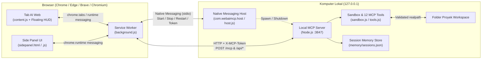

# Web AI MCP Agent


**Web AI MCP Agent** adalah kombinasi **Browser Extension (Manifest V3)** dan **Local Sandboxed Model Context Protocol (MCP) Server** yang mengubah antarmuka web AI favorit Anda (**ChatGPT, Claude, Gemini, AI Studio, DeepSeek, Qwen, Grok, Perplexity, Poe, Mistral, Copilot**) menjadi **AI Coding Agent lokal otonom** — lengkap dengan **Auto-Loop tanpa copy-paste**, **Memori Session Lintas AI**, dan **Auto-Start Server** via Native Messaging Host.

---

## Daftar Isi

- [Fitur Utama](#fitur-utama)
- [Platform AI Web yang Didukung](#platform-ai-web-yang-didukung)
- [Arsitektur Sistem](#arsitektur-sistem)
- [Struktur Proyek](#struktur-proyek)
- [Prasyarat](#prasyarat)
- [Instalasi & Setup](#instalasi--setup)
- [Cara Penggunaan](#cara-penggunaan)
- [Memori Lintas AI (Cross-AI Handoff)](#memori-lintas-ai-cross-ai-handoff)
- [Referensi MCP Tools (12 Tools)](#referensi-mcp-tools-12-tools)
- [Referensi HTTP API](#referensi-http-api)
- [Konfigurasi Server](#konfigurasi-server)
- [Arsitektur Keamanan](#arsitektur-keamanan)
- [Pengujian (Smoke Test)](#pengujian-smoke-test)
- [Troubleshooting & Uninstall](#troubleshooting--uninstall)

---

## Fitur Utama

- **Standar MCP Streamable HTTP (`@modelcontextprotocol/sdk`)**
  Menyediakan endpoint MCP JSON-RPC 2.0 stateless (`POST /mcp`) dengan validasi skema **Zod**, kompatibel dengan extension bawaan maupun klien MCP eksternal.
- **Full Auto-Loop Agent (Zero Copy-Paste)**
  Mendeteksi blok `mcp-tool` dari balasan AI secara real-time di berbagai renderer kode (`<pre>`, **CodeMirror 6**, **Monaco Editor**, **Highlight.js**, hingga **Open Shadow DOM**), mengeksekusi tool tunggal maupun *batch array* secara otomatis, dan mengirim balik `[MCP_TOOL_RESULT]` langsung ke kolom chat AI.
- **Memori Session Lintas AI (Cross-AI Shared Memory)**
  Menyimpan tujuan (*goal*), ringkasan progres, daftar tugas selesai, rencana lanjutan (*TODO*), catatan teknis, serta pelacakan file yang diubah secara otomatis (*auto-tracked*) di sisi MCP Server. Saat satu AI mencapai batas limit, pindah ke AI lain cukup dengan **1 klik** tanpa menjelaskan ulang proyek dari awal.
- **Auto-Start Server (Native Messaging Host)**
  Menyalakan, me-restart, atau menghentikan Local MCP Server langsung dari Side Panel browser (berjalan senyap di *background*) sekaligus menyinkronkan `Auth Token` secara otomatis tanpa perlu membuka terminal manual.
- **Side Panel Interaktif (4 Tab)**
  - **Agent:** Pemilih folder workspace (Dialog Windows native, input manual, *recent workspaces*), toggle `Read-Only`, injeksi *system prompt* + struktur folder + memori aktif, *Scan & Run*, kontrol Auto-Loop, dan *Manual Tool Tester*.
  - **Memori:** Manajemen multi-session per workspace (buat, pindah, edit, reset, hapus) beserta daftar file yang otomatis terlacak.
  - **Explorer:** File explorer proyek dengan *preview* kode dan tombol 1-klik untuk menyisipkan isi file ke chat AI.
  - **Pengaturan:** Kontrol Native Host Server, konfigurasi koneksi, daftar MCP tools aktif, dan log eksekusi hingga 60 aktivitas terakhir.
- **Floating HUD di Halaman AI Web**
  Menampilkan indikator status server (`online` / `busy` / `offline`), penghitung langkah otomatis (`AUTO x/15`), tombol cepat **Pause / Resume**, serta kartu kontrol inline tepat di atas setiap blok `mcp-tool`.
- **Sandbox Keamanan Berlapis**
  Server hanya mendengarkan di `127.0.0.1`, dilindungi token autentikasi, anti *path traversal* & *symlink escape* (`realpathSync`), pemblokiran file sensitif (`.env`, SSH key), mode `Read-Only` 1-klik, dan persetujuan manual wajib untuk `delete_file`.

---

## Platform AI Web yang Didukung

Extension ini terintegrasi langsung pada platform AI berbasis web berikut:

| Platform | Domain yang Didukung |
| :--- | :--- |
| **ChatGPT** | `chatgpt.com`, `chat.openai.com` |
| **Claude** | `claude.ai` |
| **Google Gemini** | `gemini.google.com` |
| **Google AI Studio** | `aistudio.google.com` |
| **DeepSeek** | `chat.deepseek.com` |
| **Qwen** | `chat.qwen.ai`, `chat.qwenlm.ai` |
| **Grok** | `grok.com` |
| **Perplexity** | `www.perplexity.ai` |
| **Poe** | `poe.com` |
| **Mistral Le Chat** | `chat.mistral.ai` |
| **Microsoft Copilot** | `copilot.microsoft.com` |

---

## Arsitektur Sistem



---

## Struktur Proyek

```text
web-ai-mcp/
├── install-native-host.bat        # Daftarkan Native Messaging Host ke Registry Windows (Chrome/Edge/Brave/Chromium)
├── uninstall-native-host.bat      # Hapus pendaftaran Native Messaging Host dari Registry Windows
├── start-server.bat               # Jalankan Local MCP Server secara manual lewat terminal
├── README.md                      # Dokumentasi proyek
│
├── extension/                     # Browser Extension (Manifest V3)
│   ├── manifest.json              # Konfigurasi ekstensi, permission, dan daftar host AI web
│   ├── background.js              # Service worker: MCP JSON-RPC 2.0 client, Native Host bridge, state & log
│   ├── content.js                 # Detektor blok mcp-tool (multi-renderer), Auto-Loop queue, Floating HUD
│   ├── content.css                # Styling Floating HUD & kartu eksekusi inline di halaman AI web
│   ├── sidepanel.html             # Struktur UI Side Panel (4 tab: Agent, Memori, Explorer, Pengaturan)
│   ├── sidepanel.css              # Styling Side Panel
│   ├── sidepanel.js               # Logika Side Panel, System Prompt Builder, Memory & Explorer UI
│   └── icons/                     # Ikon ekstensi (16px, 48px, 128px)
│
└── mcp-server/                    # Local Sandboxed MCP Server (Node.js ESM)
    ├── package.json               # Dependensi (@modelcontextprotocol/sdk, zod) & npm scripts
    ├── config.json                # Konfigurasi host, port, authToken, workspaceRoot, keamanan
    ├── memory/
    │   └── sessions.json          # Penyimpanan persisten Memori Session lintas AI per workspace
    ├── native-host/
    │   ├── com.webaimcp.host.json # Manifest Native Messaging Host (path & allowed_origins)
    │   ├── host.bat               # Wrapper eksekutor Node.js untuk Native Host di Windows
    │   └── host.js                # Implementasi Native Messaging stdio (start/stop/restart/status)
    └── src/
        ├── index.js               # HTTP Server, CORS, Auth, Endpoint /mcp & Workspace/Memory REST API
        ├── config.js              # Loader, auto-generator token, dan penyimpan config.json
        ├── sandbox.js             # Validasi keamanan path, anti traversal/symlink escape, filter biner
        ├── tools.js               # Registrasi 12 MCP Tools (9 workspace tools + 3 memory tools)
        ├── memory.js              # Manajemen session memori, auto-tracking file, & formatter handoff
        └── smoke-test.js          # Automated integration & security smoke test
```

---

## Prasyarat

- **Node.js** versi **18.0 atau lebih baru** (disarankan **v20+ LTS**, dibutuhkan untuk dukungan ESM & `fetch` native).
- **Browser berbasis Chromium**: Google Chrome, Microsoft Edge, Brave, atau Chromium.
- **Sistem Operasi**: Windows 10/11 (untuk fitur *Native Messaging Host* `.bat` dan dialog pemilih folder native Windows; inti MCP Server Node.js sendiri bersifat lintas platform).

---

## Instalasi & Setup

### 1. Instal Dependensi MCP Server

Buka terminal di direktori proyek, lalu instal dependensi pada folder `mcp-server`:

```bash
cd mcp-server
npm install
```

### 2. Pasang Browser Extension

1. Buka halaman ekstensi browser Anda:
   - Chrome: `chrome://extensions`
   - Edge: `edge://extensions`
   - Brave: `brave://extensions`
2. Aktifkan **Developer mode** (Mode pengembang).
3. Klik **Load unpacked** (Muat ekstensi yang belum dibuka).
4. Pilih folder `extension/` di dalam direktori proyek ini.

> **Catatan:** `extension/manifest.json` menyertakan properti `"key"` agar ID ekstensi bersifat tetap (`kpblbaiiiiohhjjlfmajbclnkckjenbb`) sehingga langsung cocok dengan konfigurasi `allowed_origins` pada Native Messaging Host.

### 3. Daftarkan Native Messaging Host (Disarankan)

Agar browser dapat menyalakan, me-restart, dan menghentikan MCP Server secara otomatis tanpa membuka terminal manual:

1. Pastikan nilai `"path"` di [`mcp-server/native-host/com.webaimcp.host.json`](mcp-server/native-host/com.webaimcp.host.json) mengarah ke lokasi absolut `host.bat` di komputer Anda (default: `D:\laragon\web-ai-mcp\mcp-server\native-host\host.bat`).
2. Jalankan (double-click) **`install-native-host.bat`** di folder root proyek.
3. Script akan mendaftarkan host `com.webaimcp.host` ke Windows Registry (`HKCU`) untuk **Chrome, Edge, Brave, dan Chromium** (tidak memerlukan hak Administrator).

### 4. Jalankan & Hubungkan Server

Anda memiliki dua cara untuk menjalankan MCP Server:

- **Cara A — Otomatis via Extension (Rekomendasi):**
  Buka Side Panel **Web AI MCP Agent** (klik ikon ekstensi di toolbar browser). Jika Native Host sudah terpasang dan opsi **Auto-start server otomatis** aktif, server akan langsung menyala di *background* dan **Auth Token** akan tersinkronisasi secara otomatis.
- **Cara B — Manual via Terminal:**
  Double-click **`start-server.bat`** (atau jalankan `npm start` di dalam `mcp-server/`). Salin **Auth Token** yang muncul di terminal, buka tab **Pengaturan** di Side Panel, tempel token tersebut, lalu klik **Simpan & Hubungkan**.

---

## Cara Penggunaan

### 1. Pilih Folder Proyek Target

1. Buka situs AI web pilihan Anda (misalnya ChatGPT, Claude, Gemini, DeepSeek, atau Qwen).
2. Buka **Side Panel** lewat ikon toolbar atau tombol mengambang **MCP Agent** di pojok kanan bawah halaman.
3. Di tab **Agent**, pilih folder proyek dengan salah satu cara:
   - Klik **📂 Pilih Folder...** untuk membuka dialog folder native Windows.
   - Atau klik **Ketik Path** untuk memasukkan path manual / memilih dari *recent workspaces*.
4. Aktifkan sakelar **Read-Only** jika Anda hanya ingin AI membaca kode tanpa izin mengubah file.

### 2. Aktifkan Agent di Chat AI

1. *(Opsional)* Tulis tugas awal pada kolom teks di bagian **Aktifkan / Lanjut Agent di AI Web** (contoh: *"Pelajari struktur proyek ini lalu perbaiki bug autentikasi di `src/auth.js`"*).
2. Klik **⚡ Mulai / Lanjut di AI Ini**.
3. Extension akan secara otomatis menyisipkan dan mengirim **System Prompt MCP** (daftar 12 tools, aturan format `mcp-tool`, struktur folder proyek, dan memori session aktif bila ada) ke chat AI.

### 3. Biarkan Auto-Loop Bekerja

Saat AI membalas dengan blok kode `mcp-tool`:

```mcp-tool
{
  "tool": "read_file",
  "arguments": {
    "path": "src/index.js",
    "startLine": 1,
    "endLine": 120
  }
}
```

AI juga dapat memanggil beberapa tool sekaligus dalam format *array* JSON:

```mcp-tool
[
  { "tool": "find_files", "arguments": { "pattern": "*.js" } },
  { "tool": "search_files", "arguments": { "query": "TODO", "path": "src" } }
]
```

Extension akan otomatis:
1. Menunggu AI selesai melakukan *streaming* balasan.
2. Menampilkan kartu status inline di atas blok `mcp-tool` (`MCP READ`, `MCP WRITE`, atau `MCP DELETE`).
3. Menjalankan tool pada Local MCP Server (sesuai pengaturan toggle Auto-run).
4. Memformat hasil ke dalam blok `[MCP_TOOL_RESULT]` dan mengirimkannya kembali ke AI hingga tugas selesai (maksimal **15 langkah otomatis** per giliran untuk mencegah *infinite loop*).

> **Kontrol Cepat:** Gunakan tombol **`⚡ AUTO x/15`** pada Floating HUD di pojok kanan bawah untuk menjeda (**`⏸ PAUSED`**) atau melanjutkan eksekusi otomatis kapan saja. Jika ada blok `mcp-tool` yang tidak terpicu otomatis, klik **▶ Scan & Jalankan Balasan AI Terakhir** di tab **Agent**.

---

## Memori Lintas AI (Cross-AI Handoff)

Salah satu keunggulan utama **Web AI MCP Agent** adalah penyimpanan memori session terpusat di MCP Server (`mcp-server/memory/sessions.json`), terpisah per folder workspace:

1. **Auto-Tracking Otomatis:** Setiap kali tool `write_file`, `edit_file`, `create_directory`, atau `delete_file` berhasil dijalankan, MCP Server otomatis mencatat file tersebut ke `filesTouched` dan `recentActions` — meskipun AI terkena *rate limit* mendadak sebelum sempat merangkum.
2. **Pembaruan Progres oleh AI:** AI diinstruksikan memanggil `update_session_memory` setiap menyelesaikan tahap penting untuk menyimpan `goal`, `summary`, `completedTasks`, `nextSteps`, dan `notes`.
3. **Pindah AI dalam 1 Klik:**
   - Buka tab AI web lain (misalnya pindah dari **Claude** yang kena limit ke **Gemini**, **DeepSeek**, atau **ChatGPT**).
   - Buka Side Panel → tab **Memori** (atau tab **Agent**).
   - Klik **🔄 Lanjut di AI Ini (Kirim Memori)**.
   - AI baru langsung menerima konteks lengkap proyek beserta daftar TODO dan file yang terakhir disentuh, lalu melanjutkan pekerjaan dari titik terakhir!

---

## Referensi MCP Tools (12 Tools)

### Workspace Tools — Read-Only

| Nama Tool | Akses | Parameter Utama | Deskripsi |
| :--- | :---: | :--- | :--- |
| `get_workspace_info` | `READ` | `depth?` (1–4, default `2`) | Menampilkan path workspace aktif, mode akses (`READ-ONLY`/`READ-WRITE`), dan pohon direktori ringkas. |
| `list_directory` | `READ` | `path?` (default `"."`), `depth?` (1–5, default `2`) | Menampilkan struktur file dan subfolder (maksimal 200 item, mengabaikan `ignoredDirs` & `blockedFileNames`). |
| `read_file` | `READ` | `path*`, `startLine?`, `endLine?` | Membaca isi file teks dengan nomor baris (default maks 400 baris per panggilan; menolak file biner/terlalu besar). |
| `search_files` | `READ` | `query*`, `path?`, `isRegex?`, `caseSensitive?`, `extension?`, `maxResults?` | Pencarian teks atau RegExp di dalam file workspace layaknya `grep` (default maks 50 hasil). |
| `find_files` | `READ` | `pattern*`, `path?`, `maxResults?` | Mencari nama file berdasarkan substring atau wildcard (mis. `"*.js"`, `"*controller*"`). |

### Workspace Tools — Write & Delete

| Nama Tool | Akses | Parameter Utama | Deskripsi |
| :--- | :---: | :--- | :--- |
| `write_file` | `WRITE` | `path*`, `content*` | Membuat file baru atau menimpa isi file (membuat parent folder otomatis). |
| `edit_file` | `WRITE` | `path*`, `oldText*`, `newText*`, `replaceAll?` | Mengubah bagian tertentu dengan *exact search & replace* sambil mempertahankan gaya *line-ending* (`CRLF`/`LF`). |
| `create_directory` | `WRITE` | `path*` | Membuat folder baru (rekursif) di dalam workspace. |
| `delete_file` | `DELETE` | `path*`, `recursive?` | Menghapus file atau folder (selalu wajib klik persetujuan manual; tidak pernah bisa menghapus folder root workspace). |

### Session Memory Tools (Lintas AI)

| Nama Tool | Akses | Parameter Utama | Deskripsi |
| :--- | :---: | :--- | :--- |
| `get_session_memory` | `READ` | *(tanpa parameter)* | Membaca ringkasan lengkap memori session aktif (goal, summary, tugas selesai, file diubah, TODO, catatan). |
| `update_session_memory` | `WRITE` | `goal?`, `summary?`, `addCompleted?`, `setNextSteps?`, `addNote?`, `aiSource?` | Memperbarui memori session aktif di MCP Server agar tersimpan lintas platform AI. |
| `list_sessions` | `READ` | *(tanpa parameter)* | Menampilkan daftar seluruh session memori yang tersimpan untuk workspace aktif. |

*\* Parameter bertanda bintang wajib diisi.*

---

## Referensi HTTP API

Server berjalan secara default di `http://127.0.0.1:3847`. Semua endpoint selain `/health` wajib menyertakan header autentikasi `X-MCP-Token: <token>` atau `Authorization: Bearer <token>`.

| Method | Endpoint | Auth | Deskripsi |
| :--- | :--- | :---: | :--- |
| `GET` | `/health` | Publik | Cek status server (`ok`, nama, versi, protokol) tanpa membocorkan path atau token. |
| `POST` | `/mcp` | Wajib | Endpoint standar **MCP Streamable HTTP** (JSON-RPC 2.0: `initialize`, `tools/list`, `tools/call`). |
| `GET` | `/api/workspace` | Wajib | Mengambil info workspace aktif, daftar isi folder (`?dir=...`), dan pohon folder opsional (`&tree=1`). |
| `POST` | `/api/workspace` | Wajib | Memperbarui `workspaceRoot` dan/atau mode `readOnly`. |
| `POST` | `/api/pick-folder` | Wajib | Membuka dialog pemilihan folder native Windows (`FolderBrowserDialog` via PowerShell STA). |
| `GET` | `/api/file-preview` | Wajib | Membaca isi file teks (`?path=...`) untuk fitur preview & sisip cepat di tab Explorer. |
| `GET` | `/api/memory` | Wajib | Mengambil session aktif, daftar semua session workspace, dan *handoff markdown*. |
| `POST` | `/api/memory` | Wajib | Mengelola session memori (`action`: `update`, `create`, `switch`, `delete`, `reset`). |
| `POST` | `/api/shutdown` | Wajib | Menghentikan server secara halus (*graceful shutdown*), digunakan oleh Native Host. |

---

## Konfigurasi Server

File konfigurasi tersimpan di [`mcp-server/config.json`](mcp-server/config.json) dan akan dibuat secara otomatis saat server pertama kali dijalankan:

```json
{
  "host": "127.0.0.1",
  "port": 3847,
  "authToken": "auto",
  "readOnly": false,
  "workspaceRoot": "D:\\laragon\\proyek-anda",
  "recentWorkspaces": [],
  "maxFileSizeBytes": 1048576,
  "ignoredDirs": [
    ".git",
    "node_modules",
    "vendor",
    ".next",
    "dist",
    "build",
    "__pycache__",
    ".venv",
    ".idea",
    ".vscode"
  ],
  "blockedFileNames": [
    ".env",
    ".env.local",
    ".env.production",
    "id_rsa",
    "id_ed25519"
  ]
}
```

| Properti | Default | Penjelasan |
| :--- | :--- | :--- |
| `host` | `"127.0.0.1"` | Alamat bind server. Pertahankan `127.0.0.1` agar hanya dapat diakses dari komputer lokal. |
| `port` | `3847` | Port HTTP Local MCP Server. |
| `authToken` | `"auto"` | Jika bernilai `"auto"` atau kosong, server otomatis menghasilkan token acak 32 karakter hex (16 byte). |
| `readOnly` | `false` | Jika `true`, semua operasi tulis/edit/hapus ditolak pada level server. |
| `workspaceRoot` | Folder root | Direktori proyek aktif yang menjadi batas sandbox. |
| `recentWorkspaces` | `[]` | Riwayat hingga 12 folder workspace terakhir yang digunakan. |
| `maxFileSizeBytes` | `1048576` (1 MB) | Batas ukuran maksimum file yang dapat dibaca atau ditulis. |
| `ignoredDirs` | `[...]` | Daftar folder yang disembunyikan dari pemindaian `list_directory`, `search_files`, dan `find_files`. |
| `blockedFileNames` | `[...]` | Daftar nama file sensitif yang aksesnya diblokir total oleh sandbox. |

---

## Arsitektur Keamanan

1. **Strictly Localhost:** Server hanya *listen* pada `127.0.0.1` dan menolak *Origin* browser selain `chrome-extension://`, `moz-extension://`, `http://localhost`, dan `http://127.0.0.1`.
2. **Autentikasi Token Wajib:** Semua endpoint MCP dan REST API memerlukan header `X-MCP-Token` (atau `Authorization: Bearer`) yang cocok dengan `config.json`.
3. **Sandbox Path Ketat (`sandbox.js`):**
   - Validasi leksikal dan `fs.realpathSync` mencegah *path traversal* (`../../`), perpindahan drive Windows, karakter null (`\0`), serta *symlink escape* (termasuk validasi *ancestor directory* untuk file yang belum ada).
4. **Proteksi File Sensitif & Biner:**
   - File pada `blockedFileNames` (`.env`, `.env.local`, `.env.production`, `id_rsa`, `id_ed25519`) tidak pernah bisa dibaca, diedit, atau ditampilkan di Explorer.
   - Deteksi *null-byte* otomatis mencegah pembacaan/pengeditan file biner.
5. **Pengaman Operasi Destruktif:**
   - `delete_file` **tidak pernah** dapat dieksekusi oleh Auto-Loop — selalu membutuhkan klik persetujuan manual dari pengguna, dan folder root workspace tidak pernah boleh dihapus.
   - Batas `maxAutoSteps = 15` mencegah AI melakukan eksekusi berulang tanpa henti.

---

## Pengujian (Smoke Test)

Proyek ini menyediakan *automated smoke test* untuk memverifikasi autentikasi, protokol MCP, sandbox keamanan, operasi CRUD file, serta memori session secara menyeluruh:

```bash
cd mcp-server
npm run test:smoke
```

Skenario yang diuji secara otomatis:
- Penolakan `401 Unauthorized` saat mengakses API tanpa token.
- Handshake `initialize` & daftar `tools/list` pada endpoint `POST /mcp`.
- Eksekusi `get_workspace_info`.
- Pemblokiran *path traversal* (`../../Windows/win.ini`).
- Siklus lengkap `write_file` → `edit_file` → `read_file` → `delete_file`.
- Penyimpanan & pembacaan Memori Session (`update_session_memory`, `get_session_memory`, auto-tracking file, dan reset via `/api/memory`).

---

## Troubleshooting & Uninstall

### Native Host gagal dijalankan (`Native Host gagal ...`)
- Pastikan Anda sudah menjalankan **`install-native-host.bat`** minimal sekali.
- Jika Anda memindahkan folder proyek dari lokasi awal, perbarui properti `"path"` di [`mcp-server/native-host/com.webaimcp.host.json`](mcp-server/native-host/com.webaimcp.host.json) sesuai lokasi baru `host.bat`, lalu jalankan ulang `install-native-host.bat`.
- Cek file log server di `mcp-server/server.log` untuk melihat pesan error detail.

### Blok `mcp-tool` tidak otomatis berjalan di halaman AI web
- Pastikan AI mengeluarkan blok `mcp-tool` langsung di chat biasa (**bukan** di dalam Canvas / Artifact terpisah).
- Pastikan mode **AUTO** pada Floating HUD tidak dalam kondisi **`⏸ PAUSED`**, atau batas 15 langkah otomatis belum tercapai.
- Klik tombol **▶ Scan & Jalankan Balasan AI Terakhir** di tab **Agent** untuk memicu pemindaian paksa.

### Error `401 Unauthorized`
- Klik tombol **↻** (Hubungkan ulang) di pojok kanan atas Side Panel agar ekstensi menyinkronkan token terbaru dari Native Host, atau salin ulang nilai `authToken` dari `mcp-server/config.json` ke tab **Pengaturan**.

### Uninstall Native Messaging Host
Jalankan **`uninstall-native-host.bat`** untuk menghapus seluruh entri Registry `com.webaimcp.host` dari Chrome, Edge, Brave, dan Chromium, lalu hapus ekstensi dari halaman `chrome://extensions`.
